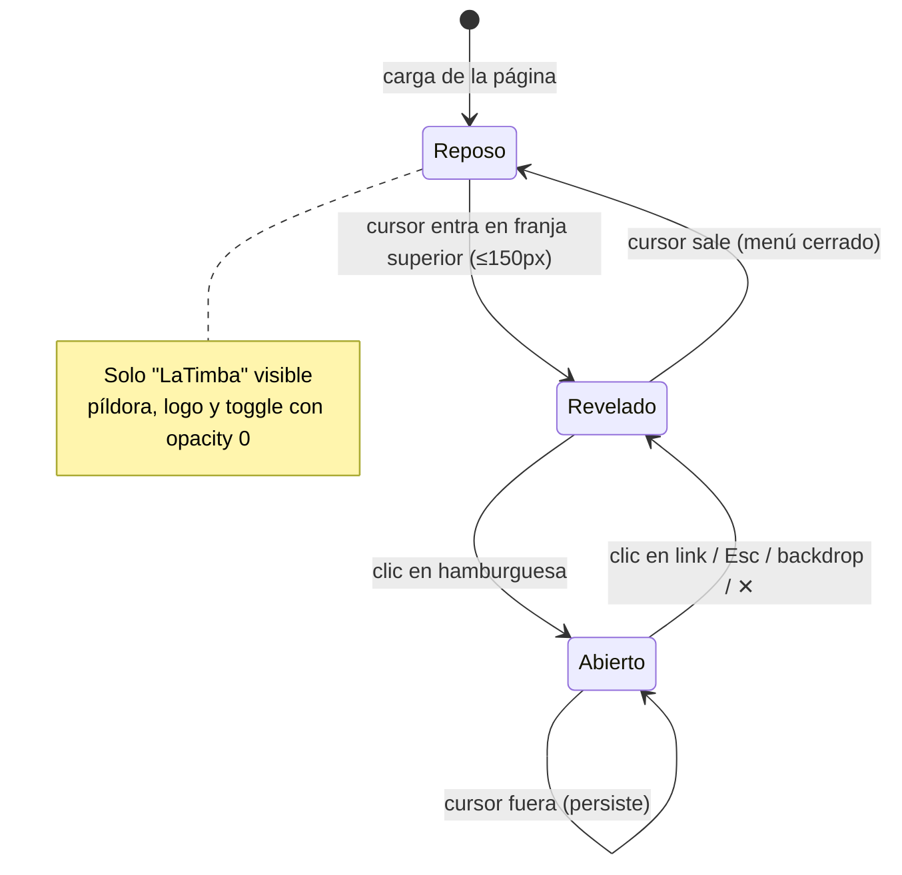
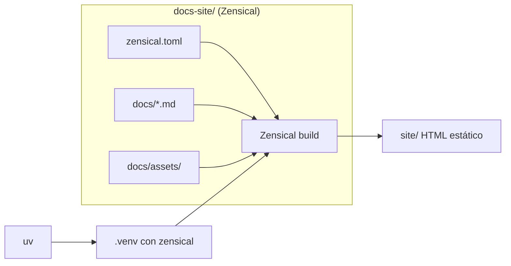

# Arquitectura

Descripción técnica de la solución: stack, estructura de archivos,
sistema de estados del navbar y flujo de interacción.

---

## 1. Stack

| Capa | Elección | Justificación |
| ---- | -------- | ------------- |
| Marcado | HTML5 semántico | Estructura única, sin SSR ni build |
| Estilos | CSS3 (custom properties, grid, backdrop-filter) | Tokens de diseño en `:root`; animaciones nativas |
| Lógica | JavaScript vanilla (~90 líneas) | Solo se necesita gestión de estados del menú; cero dependencias |
| Tipografía | Google Fonts (Poppins) | Cargada vía `<link>`, con fallback a `system-ui` |
| Documentación | Zensical + `uv` | Docs como código, build estático |

**No hay** framework, bundler, package manager de frontend ni servidor:
la landing funciona abriendo `index.html` con doble clic.

---

## 2. Estructura del repositorio

```text
latimba/
├─ index.html              # Landing one-page (navbar + wireframe)
├─ styles.css              # Tokens, navbar y placeholders del wireframe
├─ script.js               # Estados del navbar (open/close/reveal)
├─ Dockerfile              # nginx:alpine — deploy en Railway (puerto 80)
├─ assets/
│  └─ latimba-logo.jpg     # Isotipo (descargado a local)
├─ preview/                # Screenshots de verificación
└─ docs-site/              # Repo de documentación (Zensical)
   ├─ zensical.toml        # Configuración del sitio de docs
   ├─ pyproject.toml       # Proyecto uv (zensical como dev-dependency)
   ├─ docs/
   │  ├─ index.md          # Inicio de la documentación
   │  ├─ srs.md            # SRS
   │  ├─ architecture.md   # Este documento
   │  ├─ design.md         # Documento de diseño
   │  └─ assets/           # Logo para la documentación
   └─ .github/workflows/   # Workflow de GitHub Pages ( generado )
```

---

## 3. Arquitectura del navbar (Dynamic Island)

El navbar es un único elemento `<nav class="island">` posicionado `fixed`
y centrado con `translateX(-50%)`. Sus capas:

```text
nav.island
├─ ::before            → capa glass "iced" translúcida [z:0]
├─ .island-header      → logo · wordmark "LaTimba" · toggle     [z:1]
└─ .island-menu
   ├─ .island-body     → panel: .menu-links (columna) | .video-slot
   └─ .island-footer   → claims: Querétaro · clase+baile · Síguenos
```

### 3.1 Sistema de estados

La visibilidad de las capas no depende de un solo mecanismo, sino de la
**combinación** de cuatro señales. Cualquiera de ellas revela el navbar:

| Señal | Origen | Semántica |
| ----- | ------ | --------- |
| `:hover` | CSS | Cursor sobre la propia píldora |
| `.is-hover` | JS (`mousemove` en `document`) | Cursor en la **franja superior** (~150px), aunque no esté sobre la píldora |
| `:focus-within` | CSS | Navegación por teclado dentro del navbar |
| `.is-open` | JS | Menú desplegable abierto (anula el colapso al salir el cursor) |
| `.no-hover` | JS (`matchMedia('(hover: none)')`) | Dispositivo táctil: siempre revelado |



### 3.2 Flujo del reveal

1. `document.addEventListener('mousemove', ...)` compara `e.clientY` con
   `HOVER_ZONE_HEIGHT = 150` y sincroniza la clase `.is-hover` en la isla.
2. CSS reacciona a las cinco señales con selectores idénticos para las tres
   piezas revelables: la capa glass (`::before`), el logo (`.island-logo`)
   y el toggle (`.island-toggle`).
3. Todas las transiciones comparten la curva iOS `cubic-bezier(0.32, 0.72, 0, 1)`
   con duración de 0.5–0.55s, para que el movimiento se sienta elástico.

### 3.3 Gestión del menú

`script.js` expone `openMenu()` / `closeMenu()` que sincronizan:

- La clase `.is-open` en la isla (dispara expansión del panel)
- La clase `menu-open` en `<body>` (bloquea scroll y muestra el backdrop)
- Los atributos `aria-expanded` y `aria-label` del toggle

Los listeners de cierre: `backdrop.click`, `keydown (Escape)`, links
(`preventDefault` + `scrollIntoView` tras 350ms) y **gestos de scroll**
(`wheel` / `touchmove` en `document`, sin `preventDefault`): con el menú
abierto el body está bloqueado; el primer gesto cierra el panel, libera el
lock y el desplazamiento continúa de forma natural — funciona igual con
scroll natural de Mac en cualquier dirección.

### 3.4 Tokens de diseño (variables CSS)

```css
:root {
  --island-w: min(532px, calc(100vw - 24px));        /* 30% más angosto */
  --island-w-open: min(638px, calc(100vw - 48px));   /* +20% del ancho base */
  --island-header-h: 84px;
  --menu-body-h: 360px;  /* cuerpo del panel (links | video); 560px en ≤900px */
  --island-radius: 18px;
  --accent: #e8843c;     /* naranja del logo */
}
```

---

## 4. Arquitectura de la documentación



- **`uv init --bare`** creó el proyecto Python y **`uv add --dev zensical`**
  fijó la versión en `pyproject.toml` + `uv.lock`.
- **`uv run zensical serve`** para previsualizar; **`uv run zensical build`**
  genera `site/`.
- La navegación, el idioma (`es`) y las features del tema se declaran en
  `zensical.toml`; mermaid habilitado vía `pymdownx.superfences`.

---

## 5. Decisiones de arquitectura (ADR resumidos)

| # | Decisión | Alternativa descartada | Motivo |
| - | -------- | ---------------------- | ------ |
| 1 | Vanilla JS en un solo archivo | React/Vue, Tailwind | El alcance (1 navbar + wireframe) no justifica el costo; portabilidad total |
| 2 | Estado del reveal por clases + `matchMedia` | IntersectionObserver, listeners por elemento | Un listener global de `mousemove` cubre toda la franja con complejidad mínima |
| 3 | Glass con `::before` en la isla | Fondo sólido en la píldora | Permite desvanecer la capa glass sin tocar el layout del header |
| 4 | Documentación con Zensical/`uv` | MkDocs Material, Docusaurus | Generador moderno del equipo de Material; `uv` fija entorno reproducible |
| 5 | Logo copiado a local | Hotlink a gstatic | La URL firmada de gstatic expira; local = offline y estable |
| 6 | Deploy en Railway con `Dockerfile` (nginx:alpine) | Static build de docs, `npx serve` | La landing es estática; nginx en el puerto 80 es liviano, sin build step y 100% predecible |

---

## 6. Despliegue

El sitio se publica en Railway:

- **Proyecto**: `latimbaqro.org` (ambiente `production`).
- **Servicio**: conectado al repo público
  [`riosisraelg/latimba`](https://github.com/riosisraelg/latimba), rama
  `main` — cada push dispara un deploy automático.
- **Dominio público**: https://latimbaqroorg-production.up.railway.app
  (service domain `*.up.railway.app`, `targetPort: 80`).
- **Imagen**: `Dockerfile` mínimo — `nginx:alpine` copiando
  `index.html`, `styles.css`, `script.js` y `assets/` a
  `/usr/share/nginx/html`. Sin build step ni dependencias de runtime.

Solo la landing se despliega; `docs-site/` y `preview/` quedan fuera de
la imagen (documentación de desarrollo, se construye localmente con
`uv run zensical build`).
