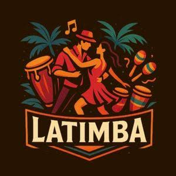

# Diseño

Documento de diseño visual y de experiencia de la landing de LaTimba.

---

## 1. Identidad

| Elemento | Valor |
| -------- | ----- |
| Nombre | **LaTimba** (wordmark con capitalización "LaTimba") |
| Isotipo | Logo circular: pareja bailando, congas, maracas y palmas sobre fondo café oscuro con marco "LATIMBA" |
| Tipografía | Poppins — 800 para el wordmark, 600 para links |
| Acento | Naranja `#e8843c` (tomas del logo; usado en el punto de "Síguenos") |
| Neutrales | Escala de grises para el wireframe: `#fafafa` fondo, `#ececec` boxes, `#d6d6d6` bordes, `#a3a3a3` etiquetas |

{ width="120" }

---

## 2. Navbar — Dynamic Island

La única sección con diseño final. Inspirado en el navbar de Sunday Robotics.

### 2.1 Estados

**Reposo** — minimalista: solo el texto **"LaTimba"** centrado. La píldora,
el logo y el hamburguesa están ocultos.

**Revelado** — al entrar el cursor a la franja superior aparece la píldora
completa: logo circular · wordmark · botón hamburguesa (box gris claro,
igual que la referencia).

**Expandido** — clic en el hamburguesa: la isla crece a un **panel grande**
(links apilados + video) y el botón rota a ✕. El scroll de la página se
bloquea; **cualquier gesto de scroll** (rueda o swipe, en cualquier
dirección — scroll natural de Mac incluido) cierra el panel y libera el
desplazamiento para navegar.

### 2.2 Medidas y tokens

| Propiedad | Valor |
| --------- | ----- |
| Ancho compacto | `min(532px, 100vw - 24px)` — **30% más angosto** que el diseño original (760px) |
| Ancho expandido | `min(1040px, 100vw - 48px)` — panel grande estilo Sunday |
| Altura del header | `84px` |
| Altura expandida | `556px` — header (84px) + cuerpo (400px) + footer de claims (72px) |
| Radio de esquinas | `18px` — **cuadrado con esquinas levemente redondeadas** |
| Curva de animación | `cubic-bezier(0.32, 0.72, 0, 1)` (iOS), 0.5–0.55s |

### 2.3 Glass translúcido "iced"

El contenedor nunca es blanco sólido: es una **capa glass helada y
transparente** aplicada en `::before`, presente tanto en el estado
compacto/revelado como en el panel abierto (con blur ligeramente mayor
para legibilidad). El fondo real de la página siempre se ve a través:

```css
/* revelado */
background: linear-gradient(135deg,
  rgba(255, 255, 255, 0.5), rgba(255, 255, 255, 0.22));
backdrop-filter: blur(16px) saturate(150%);

/* panel abierto (reforzado) */
background: linear-gradient(135deg,
  rgba(255, 255, 255, 0.62), rgba(255, 255, 255, 0.34));
backdrop-filter: blur(20px) saturate(160%);
```

El box de video también es semitransparente (`rgba(236,236,236,.75)`)
para no tapar el fondo. Efecto buscado: vidrio esmerilado liviano que
difumina pero **deja ver el fondo real de la página**.

### 2.4 Placeholder de video

Box **gris claro semitransparente** con borde punteado, icono de **play**
en un círculo blanco centrado y etiqueta "VIDEO · ASÍ ES UNA TIMBA". Ocupa
la mitad derecha del panel; comunica que ahí irá el video de LaTimba.

---

## 3. Wireframe de la landing

!!! warning "Es un borrador!"

    La sección `#` de la página — **toda la landing debajo del navbar** — es
    un **wireframe** en escala de grises. Ningún texto, botón o imagen de
    esta sección es contenido final; solo el navbar está terminado.

### 3.1 Vocabulario de placeholders

| Placeholder | Estilo | Uso |
| ----------- | ------ | --- |
| `.ph-tag` | Pill con borde punteado | Tag "Es un borrador!" |
| `.ph-bar` | Barra gris redondeada (`h1`, `h2`, `line`) | Títulos y líneas de texto |
| `.ph-media` | Box gris con borde punteado y label | Imagen / video futuro |
| `.ph-card` | Card blanca con borde gris | Contenedores de contenido |
| `.ph-btn` | Botón píldora (variante `.dark`) | CTAs futuros |
| `.wf-title` | Título real en gris oscuro, anclable | Encabezado de cada sección (`#clases`, `#eventos`, `#galeria`, `#nosotros`, `#contacto`); al hacer clic navega al heading |

### 3.2 Secciones del wireframe

Cada sección del navbar aparece como **título real con ancla**; el resto de
su contenido sigue siendo placeholder gris:

1. **Hero** — tag de borrador, titular placeholder, 2 CTAs y media box
2. **Marquesina de ritmos** — barra completa (salsa · bachata · cumbia…)
3. **Datos** — 3 cards de estadística
4. **Clases** — `h2` anclable (`#clases` en la landing) + grid de 3 cards con imagen, texto y botón
5. **Eventos** — `h2` anclable (`#eventos`) + filas con thumb, líneas y botón
6. **Galería** — `h2` anclable (`#galeria`) + grid 6×1 de imágenes cuadradas
7. **Nosotros** — `h2` anclable (`#nosotros`) + media y párrafos placeholder
8. **Contacto** — `h2` anclable (`#contacto`) + card central con titular y botón
9. **Footer** — 3 columnas de links placeholder + barra de crédito con
   **[Lyratech](https://lyratech.com.mx/)**: `© 2026 Hecho con ♥ para
   LaTimba` a la izquierda (icono heart de [Lucide](https://lucide.dev)
   inlineado como SVG estático, teñido del naranja del logo; late con
   `scale` al hacer hover sobre la barra) y "Diseñada y desarrollada por
   **Lyratech** ↗" a la derecha (patrón del footer de ABAQ)

Todas las secciones tienen `scroll-margin-top: 130px` para que al navegar
desde el navbar o desde un título, el heading quede visible bajo el navbar
fijo. Todo lo no-titulado permanece en escala de grises para que sea
imposible confundir el borrador con el diseño final.

---

## 4. Responsive

| Breakpoint | Comportamiento |
| ---------- | -------------- |
| `> 900px` | Layout de escritorio; menú en 2 columnas (links | video) |
| `≤ 900px` | Menú compacto: links a 26px, video a 280px |
| `≤ 680px` | Menú abierto a pantalla casi completa (`100dvh - 20px`), una sola columna; grids de la landing colapsan a 1 columna; galería a 3×2 |

---

## 5. Accesibilidad y movimiento

- Toggle con `aria-expanded`, `aria-controls`, `aria-label` dinámico
- Navbar revelable por teclado (`:focus-within`)
- Cierre con `++escape++`
- `prefers-reduced-motion: reduce` desactiva todas las transiciones
- Contraste: textos del wireframe en gris `#a3a3a3` solo en placeholders
  (no es contenido real); el contenido final deberá cumplir WCAG AA
